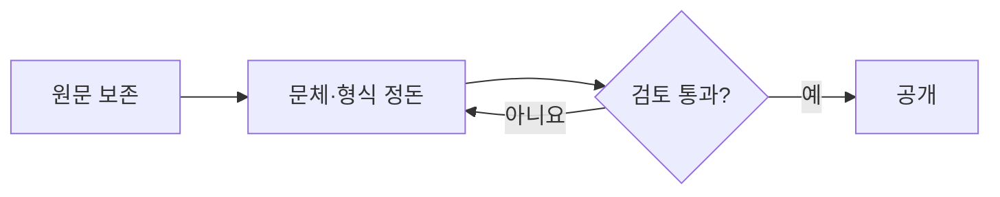

# mybr.ai 콘텐츠 작성·이관 기준

기준 글은 `astro-basics`와 `why-my-digital-brain`이다. 마크다운 스타일 예시는 문체 기준에 포함하지 않는다. 새로운 글과 티스토리 이관 글에 같은 기준을 적용한다.

## 1. 내용 보존과 수정 범위

- 이관 원문은 그대로 보관하고 별도 사본에서 편집한다.
- 주장, 근거, 사례, 코드, 수치, 환경·버전, 조건, 예외, 실패 과정, 결론을 보존한다.
- 말투, 문단, 제목 단계, 목록·표·도식 배치는 정돈할 수 있다. 문장 수보다 의미의 보존을 우선한다.
- 표·도식으로 옮긴 내용은 본문에서 반복하지 않아도 된다. 옮기는 과정에서 원인과 결과, 시간 순서, 적용 조건을 생략하지 않는다.
- 코드는 주석을 포함해 원문을 보존한다. 코드 펜스의 언어와 표시 형식만 정돈한다. 인용문은 임의로 고치지 않는다.
- 기술적 오류·오래된 설명이 의심되면 검토 항목으로 분리한다. 말투 수정에 섞어 내용을 교정하거나 최신 정보로 대체하지 않는다.
- 경험, 실행 결과, 검증 여부, 날짜를 만들어 넣지 않는다. 추측·설계·구현·검증을 구분한다.
- 글의 분리·병합, 새 설명·예시 추가, 의미가 달라지는 제목 변경은 별도 검토 대상으로 둔다.

## 2. 말투

- 개념·동작은 “~이다 / ~한다”, 경험·선택은 “~했다 / ~생각했다”로 쓴다.
- 기존 글처럼 배경 → 궁금했던 점이나 문제 → 설명·판단이 자연스럽게 이어지도록 한다.
- 짧고 구체적으로 설명한다. 독자를 가르치듯 명령하거나 과장하지 않는다.
- “완벽 이해”, “무조건”, “만능”, 장식용 감탄·이모지는 줄인다. 단, 원문 주장의 범위나 확신을 바꾸는 수정은 따로 검토한다.
- “~로 보였다”를 “~임을 확인했다”로 바꾸지 않는다. 실제 경험이 없는 개념 글에 개인 경험을 덧붙이지 않는다.
- 제품명·API·식별자는 원래 표기를 유지한다. 약어는 필요한 경우 처음 등장할 때 풀어 쓴다.

예: “이제 설정해 볼까요?” → “다음 설정을 추가한다.” / “이번 프로젝트에서 적용했습니다.” → “이번 프로젝트에서 적용했다.”

## 3. 글 구성

도입은 배경과 다룰 내용을 1~2문단으로 적는다. 긴 글은 필요할 때만 핵심 요약을 짧게 둔다. 모든 글에 동일한 목차나 별도 결론을 강제하지 않는다.

| 유형 | 기본 흐름 |
|---|---|
| 개념 | 필요한 배경 → 원리·구조 → 예시 → 적용 조건·주의점 |
| 비교 | 비교 목적 → 동일 기준의 비교표 → 차이를 보여주는 예시 → 선택 기준 |
| 가이드 | 목표·전제 → 절차 → 확인 방법 → 주의점 |
| 구현 경험 | 목표·환경 → 전체 흐름 → 구현 단계·코드 → 결과·한계 |
| 문제 해결 | 증상·환경 → 조사·원인 → 해결 과정 → 확인한 결과·남은 문제 |
| 프로젝트·회고 | 배경·역할 → 실제 작업이나 사건 → 판단·결과 → 배운 점 |

각 단계는 원문에 해당 내용이 있을 때 사용한다. 없던 결과나 확인 절차를 채우기 위해 만들어 넣지 않는다.

## 4. 컴팩트하게 표현하는 기준

| 내용 | 우선 표현 | 보존할 정보 |
|---|---|---|
| 같은 항목을 가진 대상 비교 | Markdown 표 | 비교 조건, 예외, 선택 이유 |
| 설정·환경·옵션 목록 | 짧은 목록 또는 표 | 이름, 값, 의미·제약 |
| 처리 순서·분기 | Mermaid flowchart | 분기 조건, 실패·되돌림 경로 |
| 여러 주체의 요청·응답 | Mermaid sequenceDiagram | 주체, 순서, 데이터·응답 의미 |
| 상태 전이 | Mermaid stateDiagram-v2 | 시작·종료, 전이 조건 |
| 데이터 관계 | Mermaid erDiagram | 관계 방향·기수, 필요한 속성 |
| 선택 이유·원인 분석 | 문단 | 인과관계, 근거, 불확실성 |
| 실행 가능한 예제 | 언어 지정 코드블록 | 코드 전체와 실행 전제 |

- 표는 보통 2~4열로 구성한다. 셀마다 긴 문단이 필요하면 표보다 본문이 낫다.
- 짧은 일렬 흐름은 `A → B → C`로 충분하다. 복잡성이 줄어들 때만 Mermaid를 쓴다.
- 도식은 가로 방향을 우선 고려하되 모바일에서 글자가 작아지면 여러 도식으로 나눈다. 세로 방향이 더 읽기 쉬우면 사용한다.
- 그래프를 새로 구성하면서 원문에 없는 연결이나 원인을 추론해 넣지 않는다.
- 도식 아래에는 필요할 때 읽는 법이나 중요한 조건만 설명한다. 모든 노드를 문장으로 다시 나열하지 않는다.
- 중요한 조건·주의사항은 본문에 노출한다. 부가 로그·긴 출력만 접힌 영역으로 옮길 수 있다.
- 특정 글자 수나 화면 높이를 맞추기 위해 내용을 삭제하지 않는다.

## 5. Markdown 규칙

- 제목은 frontmatter의 `title`에 두고 본문은 `##`부터 시작한다. `###`은 하위 주제, `####`는 필요할 때만 사용하고 단계를 건너뛰지 않는다.
- 제목의 번호는 실제 순서가 있을 때만 붙인다. 장식용 이모지와 반복적인 구분선은 쓰지 않는다.
- 문단은 하나의 요점을 담는다. 문장마다 빈 줄을 넣거나 `<br>`로 간격을 만들지 않는다.
- 절차는 번호 목록, 병렬 항목은 불릿 목록을 쓴다. 중첩은 가급적 한 단계로 제한한다.
- 표에는 의미 있는 머리글을 둔다. 빈 머리글이나 표 안의 표는 피한다.
- 강조는 핵심 판단·조건에만 `**굵게**`를 쓴다. 식별자·명령·파일명은 인라인 코드로 표시한다.
- 코드 펜스에는 `cpp`, `java`, `typescript`, `yaml`, `bash`, `json`, `text` 등 실제 언어를 지정한다. 출력·의사코드는 `text`를 쓴다.
- 인용문 `>`는 실제 인용이나 원문에서 강조한 명제에 사용한다. 일반 설명을 전부 인용으로 감싸지 않는다.
- 접힌 영역은 `<details><summary>…</summary>`를 사용하고, 내부 Markdown 앞뒤에 빈 줄을 둔다.
- 링크 텍스트는 이동 대상을 설명한다. 이미 이관한 글은 `../<permalink>`, 아직 이관하지 않은 글은 기존 공개 URL을 유지한다. 사이트 base를 고려해 내부 링크에 `/notes/...`를 직접 쓰지 않는다.
- 이미지에는 의미 있는 대체 텍스트를 붙인다. 회사·고객 정보, 자격 증명과 EXIF·사용 권한을 확인한 자산만 공개한다.

## 6. Mermaid

`mermaid` 코드블록으로 작성한다. 사이트가 SVG로 렌더링하며 원문은 “다이어그램 원문”에서 볼 수 있다. JavaScript가 없으면 코드 원문이 표시된다.

````markdown

````

- `accTitle`과 `accDescr`로 도식의 제목과 의미를 설명한다.
- 노드 이름은 짧고 구체적으로 쓴다. 조건·관계는 화살표에 표시한다.
- 글마다 색상·테마를 덮어쓰지 않는다. 사이트의 라이트·다크 및 데님 블루 기준을 따른다.
- HTML 라벨·클릭 이벤트에 의존하지 않는다. 링크는 본문에서 제공한다.
- 통계 그래프는 원문에 실제 수치가 있는 경우에만 사용한다.

## 7. 이관 메타데이터

- 기본 구조는 `src/content.config.ts`를 따른다. 원본 frontmatter를 그대로 복사하지 않는다.
- 실제 구현 과정은 `experience / implementation`, 증상과 원인·해결 중심이면 `experience / troubleshooting`으로 분류한다.
- `implementation`은 필요할 때 `environment`, `stack`, `projectRefs`를 쓴다. 참조할 프로젝트 글이 없으면 관계를 만들어 채우지 않는다.
- `source.type: tistory`와 `source.url`로 원문을 연결한다.
- `originalPublishedAt`은 원문 최초 발행일, `publishedAt`은 이 사이트에 공개한 날짜다. 기존 작성·수정 시점을 모르면 추정하지 않는다.
- `uid`와 `permalink`는 주제 기반으로 정하고 고정한다. `growth`는 이관 여부가 아닌 실제 정리 수준으로 정한다.
- 이관 작업 상태는 공개 콘텐츠 스키마에 넣지 않는다. `draft`는 공개 컬렉션에 추가하지 않는다.

## 8. 한 편의 완료 기준

1. 원문 각 절의 의미가 본문·표·도식 중 어디에 보존됐는지 대조한다.
2. 코드, 표의 행·열, 이미지, 링크, 조건·예외·실패 과정의 누락을 확인한다.
3. 문체 수정과 사실 변경을 구분하고 미확인 사항을 해결한다. 깨진 원문은 복구 전 공개하지 않는다.
4. 메타데이터와 문서 관계를 확인하고 `npm run check`, `npm run build`를 통과시킨다.
5. 라이트·다크와 1440 / 768 / 390px에서 표·코드·도식, 내부 이동, 원문 펼치기를 확인한다.

이 문서는 작성 기준이며, 개별 이관 글이 검토·검증·공개됐다는 기록은 아니다.

## 9. 공개 활동 기록

`/activity`는 글의 `publishedAt`에서 발행 활동을 자동 생성한다. `originalPublishedAt`, `createdAt`, Git 커밋 날짜는 발행 날짜를 대신하지 않는다. 날짜만 알면 `YYYY-MM-DD`를 쓰고, 시각을 쓰는 경우 `Z`나 명시적인 offset을 포함한다. 시각은 서울 기준 날짜에 집계된다.

확인한 수정·복습·연결만 `src/data/activities.yaml`에 수동으로 추가한다. 처음의 `[]`는 기록이 없다는 뜻이며, 기록을 추가할 때 YAML 배열로 바꾼다.

- 공통: 고유 `id`(`act-` + kebab-case), `kind`, 날짜 전용 `on`. `visibility`는 생략하거나 `public`만 쓴다.
- `revise`, `review`: 기존 글의 `noteUid`를 쓴다. 같은 글·같은 날짜의 복습은 한 건만 허용한다.
- `link`: `fromUid`, `toUid`, `relation`을 쓴다. 기존 글에 선언한 관계의 방향·유형과 일치해야 한다. `prerequisites`는 선언 글에서 선행 글로 향하는 `prerequisite`, `projectRefs`는 선언 글에서 프로젝트 글로 향하는 `part-of`다.
- 선택 `detail`은 공개할 수 있는 280자 이내 한 줄 평문이다. 수정의 선택 `evidenceKey`는 중복 근거 검사에만 쓰며 활동 JSON에는 포함하지 않는다. 이 필드도 공개 저장소에 있으므로 비밀을 넣지 않는다.

발행 활동을 수동으로 중복 입력하거나, 앞으로 쓸 글·미래 날짜·추정한 경험을 기록하지 않는다. 읽기 trail은 복습으로 집계하지 않는다. 공개 원본을 수정하면 다음 빌드에 반영된다. `npm run verify`, `node --test scripts/*.test.mjs`, `npm run check`, `npm run build`로 검증한다.

JS가 없거나 데이터 로드에 실패하면 월별 정적 목록에서 글을 읽을 수 있다. 기본 목록의 월은 빌드 시점 기준이며, 임의 query를 서버가 해석하지 않는다.

## 10. 고정 글과 즐겨찾기

홈의 "고정 글"은 `src/data/pinned.yaml`에 `id`(`pin-` + kebab-case)와 `noteUid`를 위에서부터 순서대로 적는다. 없는 UID나 같은 글의 중복 고정은 `npm run verify`가 거부한다. 고정한 글은 홈의 최근 글에서 중복해 보이지 않는다. 처음의 `[]`는 고정 글이 없다는 뜻이다.

글 상세의 별 버튼으로 하는 즐겨찾기는 방문자의 브라우저(`localStorage`의 `mybr-favorites`)에만 저장된다. 서버, 계정, 기기 간 동기화는 없고, 읽기 trail과도 별개다. 파일에 남기지 않으므로 이 문서의 검증 대상이 아니다.
