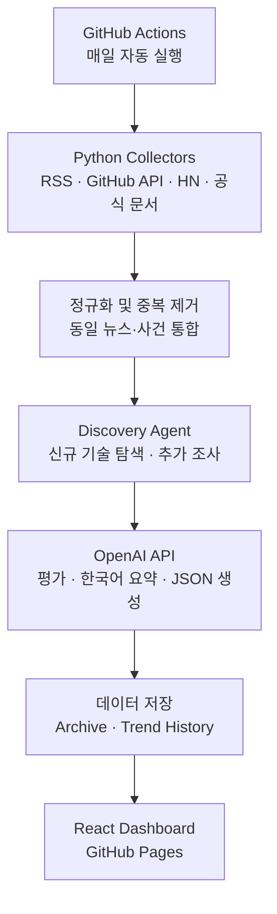

AI 시대에는 단순히 기술을 많이 아는 것보다 **새로운 정보를 얼마나 빨리 접하고, 이해하고, 자신의 일에 적용할 수 있는가**가 중요하다고 생각한다.

새로운 모델이나 도구가 등장하는 속도도 빠르지만, 그걸 활용하는 방식은 더 빠르게 바뀌고 있다. 같은 AI 도구를 사용하더라도 누군가는 단순히 질문하고 답변을 받는 데 사용하고, 누군가는 여러 도구를 연결해 자신의 업무를 자동화한다.

결국 중요한 건 어떤 도구가 존재하는지 아는 데서 끝나는 게 아니라, 그 도구로 무엇을 할 수 있는지 이해하고 실제로 써보는 것이라고 생각했다.

그런데 정작 나는 새로운 기술을 꽤 수동적으로 접하고 있었다.

> 이 글은 구현 결과가 아니라 **설계 단계의 기록**이다. 아래의 구조와 수치는 모두 초기 계획이며, 구현하면서 바뀔 수 있다.

## 1. 새로운 기술을 항상 조금 늦게 알게 됐다

돌아보면 새로운 AI 도구를 알게 되는 경로는 대부분 비슷했다.

친구가 써봤는데 좋다고 추천하거나, 학회에서 누군가 새로운 도구를 소개하거나, 회사에서 동료가 활용하는 모습을 보고 나서야 찾아보는 식이었다.

물론 이런 방식도 유용하다. 다른 사람이 직접 사용해보고 추천해 주는 것이니 어느 정도 검증된 정보를 얻을 수 있다.

하지만 **누군가 알려줘야 비로소 알게 된다는 점**이 계속 아쉬웠다.

회사에서 직접 기능을 기획하고 구현하면서 이런 생각이 더 커졌다.

처음에는 익숙한 기술을 기준으로 구현 방법을 고민하다가, 문제를 해결하기 위해 자료를 찾아보는 과정에서 우연히 새로운 도구나 접근법을 발견하곤 했다.

그러면 자연스럽게 이런 생각이 들었다.

> 이런 방법이 있었네? 처음부터 알았으면 이걸로 구현했을 텐데.

새로운 기술을 적용해보면 기존 방식보다 간단하게 해결되는 문제도 있었고, 이미 작성한 구조를 다시 고민하게 되는 경우도 있었다.

그때부터는 하나의 구현 방법을 찾더라도 곧바로 확정하기보다, 더 효율적인 방법이나 새로운 접근법이 있지 않을까 찾아보게 됐다.

그 과정 자체는 재미있었다. 새로운 기술을 발견하고, 직접 적용해보고, 기존 방식과 비교하는 경험이 꽤 흥미로웠다.

다만 여전히 **문제가 생기거나 누군가 추천해 줬을 때 비로소 탐색을 시작한다**는 한계가 있었다.

이미 알고 있는 기술을 잘 활용하는 것만큼, 아직 모르는 기술이 존재한다는 사실을 먼저 알아차리는 것도 중요하지 않을까?

그래서 필요할 때만 검색하는 방식에서 벗어나, 평소에도 새로운 기술을 능동적으로 탐색하고 적응하는 습관을 만들어보고 싶어졌다.

## 2. 정보는 넘쳐나는데, 정작 무엇을 봐야 할지 모르겠다

문제는 정보가 부족한 것이 아니었다.

오히려 정보가 너무 많았다.

OpenAI, Anthropic, Google 같은 기업의 공식 발표부터 GitHub의 오픈소스 프로젝트, Hacker News, 기술 블로그, 각종 AI 뉴스레터까지 확인할 수 있는 채널이 너무 다양하다.

이걸 전부 직접 확인하는 건 현실적으로 어렵다.

특히 내가 궁금한 건 단순한 AI 산업 뉴스보다는 실제 활용에 관한 정보다.

예를 들어 이런 것들이다.

- Claude Code의 새로운 Hooks, Skills, Subagents 활용법
- Codex나 AI 코딩 도구를 이용한 개발 워크플로 개선
- MCP와 외부 서비스 연결을 통한 자동화
- AI Agent의 새로운 설계 패턴과 검증 방법
- 컨텍스트 관리, 토큰 최적화, Agent Memory
- Generative UI와 새로운 AI 인터페이스
- 기존에 생각하지 못했던 새로운 AI 서비스와 활용 방식

이러한 정보를 한곳에서 확인하고 싶었다.

### 기존 뉴스레터로는 부족했던 부분

처음에는 이미 존재하는 AI 뉴스레터나 정보 수집 서비스를 찾아봤다.

하지만 대부분의 뉴스레터는 긴 글과 링크 중심으로 구성되어 있었다.

매일 확인하기에는 읽어야 할 내용이 많았고, 내가 관심 없는 뉴스까지 함께 살펴봐야 했다. 영어로 작성된 내용도 많아 핵심을 빠르게 파악하기 어려웠다.

내가 원했던 건 조금 달랐다.

**매일 아침 1~3분만 읽어도 중요한 변화를 알 수 있는 형태.**

긴 문장보다는 카드, 태그, 간단한 표와 시각화를 활용해 핵심만 확인하고 싶었다.

그리고 새로운 도구를 소개한다면 단순한 설명에서 끝내지 않고, 필요할 때 설치 방법이나 실제 사용 예시까지 확인할 수 있으면 좋겠다고 생각했다.

특히 ChatGPT의 GenUI처럼 정보를 구조화해서 보여주는 방식이 마음에 들었다.

그래서 기존 서비스를 더 찾아보기보다, **내가 읽기 편한 형태로 정보를 보여주는 서비스를 직접 만들기로 했다.**

## 3. 만들고 싶은 것은 뉴스레터보다 'AI Radar'에 가깝다

프로젝트 이름은 **AI Radar**로 정했다.

매일 AI 관련 소식을 수집하고, 그중 중요한 내용을 한국어로 정리해 보여주는 개인용 웹 서비스다.

처음에는 관심 있는 키워드의 업데이트만 모으면 충분할 것이라고 생각했다.

그런데 생각해보니 문제가 있었다.

내가 `MCP`, `Skills`, `Agent Harness` 같은 키워드만 수집하도록 설정하면, 앞으로 전혀 새로운 개념이 등장했을 때는 어떻게 될까?

새로운 기술은 내가 아직 이름을 모르는 기술이다. 처음부터 검색어로 등록할 수 없다는 뜻이다.

이 서비스가 기존 관심 분야만 계속 보여준다면, 결국 추천을 통해 정보를 접하던 기존 방식과 크게 다르지 않을 수도 있다.

그래서 단순한 키워드 모니터링을 넘어 **새로운 흐름 자체를 발견하는 기능**이 필요하다고 판단했다.

### 핵심 요구사항

| 구분 | 요구사항 |
|---|---|
| 자동화 | 노트북이 꺼져 있어도 매일 자동 실행 |
| 수집 | 공식 발표, GitHub, 개발 커뮤니티, 연구, 새로운 제품 |
| 탐색 | 지정된 키워드에 없는 신규 기술도 발견 |
| 선별 | 중요도, 실용성, 신뢰도를 바탕으로 뉴스 선정 |
| 요약 | 한국어로 무엇이 달라졌고 왜 중요한지 설명 |
| 활용 | 바로 따라 할 수 있는 가이드와 참고 링크 |
| 시각화 | 짧은 카드와 차트 중심의 웹 대시보드 |
| 아카이브 | 과거 뉴스와 기술의 변화 이력 보관 |

정보는 가능한 한 넓게 수집하되, 실제 화면에는 가장 중요한 3~5건만 보여주는 것을 목표로 한다.

나머지 정보도 버리지 않고 저장해 나중에 검색하거나 새로운 기술 흐름을 분석하는 데 활용할 계획이다.

## 4. 전체 아키텍처

초기에는 별도의 서버를 운영하지 않는 구조로 설계했다.

GitHub Actions에서 매일 수집·분석 작업을 실행하고, 결과를 정적 JSON으로 생성한 뒤 GitHub Pages에 배포하는 방식이다.

이 구조에서 가장 고민했던 부분은 정보 수집을 Python 코드로 처리할지, AI Agent를 활용할지였다.

### 4.1 Python 수집기와 Agent를 함께 사용하기로 했다

처음에는 OpenAI Agents SDK와 MCP를 이용해 전체 정보 수집 과정을 에이전트로 구현하려고 했다.

하지만 모든 작업에 에이전트가 필요한 것은 아니었다.

공식 RSS를 조회하거나 GitHub API에서 새로운 릴리스를 가져오는 작업은 정해진 규칙에 따라 반복된다.

이런 작업은 Python 코드가 더 단순하고, 빠르고, 실행 결과도 예측하기 쉽다.

반면 새로운 기술을 발견하고, 관련 자료를 추가로 찾아보고, 기존 기술과 비교하는 과정은 정해진 규칙만으로 처리하기 어렵다.

결국 역할을 분리하기로 했다.

| Python | AI Agent |
|---|---|
| RSS·API 수집 | 새로운 기술·개념 탐색 |
| 메타데이터 추출 | 동적인 검색어 생성 |
| 중복 제거 | 관련 자료 추가 조사 |
| 수집 이력 관리 | 기존 기술과 차이점 분석 |
| 데이터 저장·배포 | 신흥 트렌드 후보 판단 |

전체 흐름을 에이전트가 자율적으로 결정하도록 하기보다는, **반복 가능한 작업은 코드로 고정하고 판단이 필요한 부분에 에이전트를 사용하는 하이브리드 구조**를 선택했다.

### 4.2 왜 LangGraph가 아니라 OpenAI Agents SDK인가?

에이전트 구현 기술로는 LangGraph, OpenAI Agents SDK, Pydantic AI 등을 고려했다.

LangGraph는 상태 관리, 복잡한 분기, 체크포인트, 장시간 워크플로 구성에 강점이 있다.

하지만 지금 구현하려는 Discovery Agent의 역할은 상대적으로 명확하다.

1. 새로운 기술 후보를 발견한다.
2. 필요하면 웹과 GitHub를 추가 검색한다.
3. 과거에 수집한 정보와 비교한다.
4. 새로운 흐름인지 판단하고 근거를 반환한다.

여러 에이전트가 복잡하게 협업하거나 장시간 작업을 중단하고 재개할 필요는 아직 없다.

따라서 초기에는 **OpenAI Agents SDK로 단일 Discovery Agent를 구현**하기로 했다.

[Agents SDK](../openai-agents-sdk-concepts)는 Python 함수나 외부 도구를 연결하고 모델이 필요한 도구를 호출하도록 구성할 수 있다. 실행 추적도 지원하므로 에이전트가 어떤 근거로 결과를 판단했는지 확인하는 데 활용할 수 있다.

필요한 경우 MCP 서버도 연결할 수 있지만, 일반적인 API 조회까지 모두 MCP로 구현하지는 않을 계획이다.

향후 탐색 단계가 복잡해지거나 상태 기반 워크플로가 필요해진다면 LangGraph 도입을 다시 검토할 수 있다.

### 4.3 왜 GitHub Actions와 GitHub Pages인가?

이 서비스는 사용자가 요청할 때마다 실시간으로 데이터를 수집할 필요가 없다.

하루 한 번 브리핑을 생성해두면 사용자는 결과를 조회하기만 하면 된다.

따라서 초기부터 백엔드 서버와 데이터베이스를 상시 운영하기보다 배치 작업과 정적 웹을 활용하는 편이 합리적이라고 판단했다.

**GitHub Actions**

- 매일 정해진 시간에 자동 실행
- 개인 PC 상태와 무관하게 동작
- Python 수집·분석 작업 수행
- 결과 데이터 생성 및 배포 자동화

**GitHub Pages**

- 정적 웹사이트 호스팅
- React 빌드 결과와 JSON 데이터 제공
- 별도 API 서버 없이 대시보드 운영
- 초기 인프라 관리 부담 감소

다만 GitHub Actions의 실행 시각은 정확히 보장되지 않고, OpenAI API 비용도 별도로 발생한다. GitHub Pages 역시 저장소 공개 여부와 요금제에 따른 제약이 있으므로 배포 환경은 이에 맞춰 구성할 예정이다.

### 4.4 왜 React인가?

정보를 보여주는 방식이 이 프로젝트의 주요 목적이기 때문이다.

단순 HTML 뉴스레터보다 뉴스 카드, 카테고리 필터, 트렌드 차트, 펼쳐지는 사용 가이드 등 다양한 컴포넌트를 구성하고 싶었다.

React를 사용하면 데이터와 UI를 분리해 각 뉴스에 동일한 형식의 컴포넌트를 적용할 수 있다.

AI는 매일 구조화된 JSON만 생성하고, React는 그 데이터를 읽어 정해진 화면에 표시한다.

즉 **즉 AI는 데이터만 만들고, 화면은 고정된 React 컴포넌트가 담당한다. 매번 UI를 생성하는 GenUI는 아니지만, 그만큼 구조화되어 읽기 편한 화면을 목표로 한다.**를 만드는 것이다.

## 5. 정보의 양보다 선별 기준이 중요하다

처음에는 수집하는 소스가 많을수록 좋겠다고 생각했다.

하지만 수집량이 많아진다고 중요한 정보를 더 잘 발견하는 것은 아니다.

동일한 기술 발표를 여러 매체가 반복해서 소개하기도 하고, 관심을 많이 받는 프로젝트가 반드시 유용한 것도 아니다.

그래서 정보 수집과 실제 브리핑에 노출하는 과정을 분리했다.

| 단계 | 초기 목표 |
|---|---:|
| 하루 원본 수집 | 100~250건 |
| 중복 및 노이즈 제거 | 20~50건 |
| 가치 평가 및 검증 | 10~15건 |
| 최종 브리핑 | 3~5건 |

위 수치는 초기 설계 목표이며 실제 수집 데이터를 확인하면서 조정할 예정이다.

정보를 평가할 때는 다음 항목을 고려한다.

- 실제 개발이나 일상에 활용할 수 있는가?
- 기존 기술과 비교해 의미 있는 변화가 있는가?
- 얼마나 새로운 개념인가?
- 공식 문서나 독립적인 근거가 있는가?
- 내 관심 분야와 얼마나 관련이 있는가?

특히 특정 기업의 소식이나 특정 기술만 반복적으로 노출되지 않도록 출처 다양성도 고려할 계획이다.

### 새로운 기술을 어떻게 발견할 것인가?

신규 기술 탐지에는 단순 키워드 빈도 이상의 정보가 필요하다.

어떤 용어가 많이 등장한다는 이유만으로 새로운 패러다임이라고 판단할 수는 없다.

반대로 아직 널리 알려지지 않은 기술이라도 기존 접근법을 크게 바꾸는 중요한 아이디어일 수 있다.

따라서 Discovery Agent는 새로운 후보를 발견하면 과거 수집 기록과 비교하고, 관련 자료를 추가로 조사하도록 설계한다.

검토 기준은 다음과 같다.

| 기준 | 의미 |
|---|---|
| Novelty | 기존 기술과 얼마나 다른가? |
| Momentum | 최근 관심도가 증가하고 있는가? |
| Source Diversity | 서로 독립적인 출처에서 확인되는가? |
| Significance | 기술적으로 어떤 문제를 해결하는가? |
| Practical Potential | 실제 활용 가능성이 있는가? |

새로운 개념은 처음부터 독립적인 카테고리로 만들지 않는다.

먼저 자유 태그로 저장하고, 지속적으로 등장하며 의미 있는 흐름으로 확인될 때 새로운 카테고리로 승격하는 방식을 고려하고 있다.

이렇게 하면 현재 알고 있는 기술만 계속 추적하는 문제를 어느 정도 줄일 수 있을 것이다.

## 6. 최종적으로 만들고 싶은 화면

대시보드는 최대한 가볍게 만들고 싶다.

매일 아침 들어갔을 때 긴 글을 읽을 필요 없이 오늘 중요한 정보부터 확인할 수 있는 구조다.

### 오늘의 브리핑

상단에는 오늘의 수집 현황과 핵심 뉴스 3~5개가 나타난다.

각 뉴스는 세 가지 정보로 요약한다.

**💡 What — 무엇이 달라졌나?**

새롭게 공개된 기능이나 기술의 핵심 변화

**⚡ Why — 왜 중요한가?**

기존 방식과의 차이, 활용할 수 있는 상황

**🛠️ How — 어떻게 써볼 수 있나?**

실제 적용 방법이나 첫 실험 아이디어

기본 화면은 짧게 유지하고, 관심 있는 뉴스만 펼쳐서 자세한 사용법을 확인하도록 한다.

### Emerging Radar

새롭게 떠오르는 기술과 개념을 시각화하는 영역이다.

최근 등장한 기술이 무엇인지, 얼마나 빠르게 확산되고 있는지, 기존 기술과 어떤 차이가 있는지를 보여준다.

단순한 키워드 순위보다는 **새로운 기술이 등장하고 확산되는 흐름**을 추적하는 데 집중한다.

### Archive & Personal Library

과거 뉴스도 날짜와 카테고리, 기술 태그로 검색할 수 있도록 보관한다.

나중에는 관심 있는 도구를 저장하거나, 직접 사용해본 기술을 기록하는 기능도 추가하고 싶다.

그렇게 되면 단순한 뉴스 아카이브를 넘어 내가 접하고 실험했던 AI 기술의 기록이 쌓일 것이다.

## 7. 구현 계획

처음부터 모든 기능을 구현하기보다는 세 단계로 나눴다.

| 단계 | 구현 목표 | 주요 기능 |
|---|---|---|
| Phase 1 | Daily Briefing MVP | 자동 수집, 중복 제거, 한국어 요약, 카드형 대시보드, 정적 배포 |
| Phase 2 | Agentic Discovery | Discovery Agent, 동적 탐색, 신흥 기술 추적, Emerging Radar |
| Phase 3 | Personal Intelligence | 북마크, 관심도 피드백, 활용 기록, 개인화, 주간 리포트 |

첫 번째 목표는 **매일 열어볼 만한 대시보드를 안정적으로 운영하는 것**이다.

그다음 Discovery Agent를 도입해 관심사 밖의 새로운 기술을 얼마나 잘 발견하는지 확인할 계획이다.

특히 에이전트를 도입했다는 사실보다, 기존 Python 기반 수집으로 발견하지 못했던 유의미한 정보를 실제로 찾아내는지가 더 중요하다.

이를 위해 에이전트의 추가 검색 횟수와 비용을 제한하고, 발견한 결과를 직접 검토하면서 성능을 개선할 생각이다.

## 8. 이 프로젝트로 확인하고 싶은 것

AI Radar를 만든다고 해서 모든 AI 트렌드를 남들보다 먼저 알 수 있는 것은 아니다. 새로운 기술을 알아차리려면 정보원의 범위와 판단 기준이 필요하고, 그 기술을 실제로 이해하고 검증하는 과정도 필요하다. 이 서비스가 대신해 주는 것은 그중 **탐색과 선별의 일부**다.

그래도 누군가 추천해 줄 때까지 기다리는 대신, 매일 새로운 후보를 먼저 접하는 환경은 만들 수 있다고 생각한다. 이 프로젝트에서 확인하려는 것은 두 가지다.

- **발견:** Discovery Agent가 기존 Python 수집기로는 찾지 못했던 의미 있는 정보를 실제로 찾아내는가.
- **설계 판단:** 어떤 작업을 코드로 고정하고 어떤 작업을 에이전트에 맡길지, 탐색 범위와 비용을 어떻게 제한할지, 결과의 품질을 어떻게 평가할지.

두 번째는 단순히 LLM API를 호출하는 것보다 어려운 부분이어서, 직접 설계하고 운영하며 배우고 싶은 부분이기도 하다. 어느 쪽도 아직 구현하기 전이므로, 위 내용은 확인된 결과가 아니라 검증할 질문이다.

다음 글에서는 첫 번째 단계인 정보 수집 파이프라인을 구현하고, 실제 수집 결과와 문제점, 개선 과정을 정리할 예정이다.
