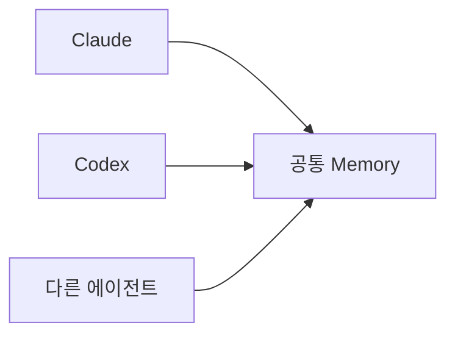
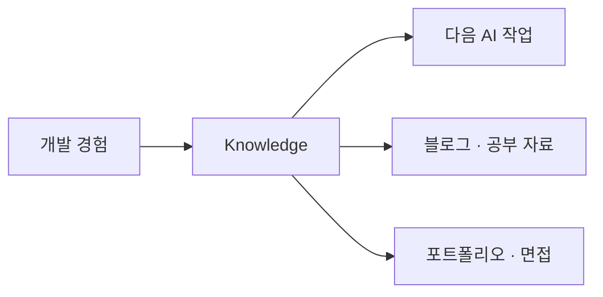

[DevWiki 구축기](../../paths/path-devwiki-build/) 1편 — 왜, 무엇을 위해 만들었나

요즘 개발할 때는 Claude Code, Codex 같은 AI 에이전트를 거의 항상 켜 둔다. 그런데 에이전트가 아무리 똑똑해져도 반복해서 마주하는 문제가 있었다. **이전 작업의 맥락을 자동으로 이어받지 못한다는 점**이다.

그 불편을 줄이려고 만든 개인 시스템이 DevWiki다. 지금도 실제 개발에 사용하면서 꾸준히 보완하고 있다. 이 시리즈에서는 DevWiki를 어떻게 만들기 시작했고, 쓰면서 무엇이 불편했으며, 어떤 결정을 거쳐 현재의 아키텍처에 이르렀는지 기록하려고 한다. 1편에서는 왜 만들었고, 무엇을 해결하고 싶었는지부터 정리한다.

## 거창한 시스템을 만들려던 게 아니다

처음부터 Agent Memory 시스템을 만들겠다고 시작한 것은 아니었다. AI와 개발하다 보니 같은 불편이 반복됐고, 그것을 줄이려다 여기까지 왔다. 그 불편은 여섯 장면으로 정리할 수 있다.

### 세션마다 프로젝트 설명을 다시 한다

어제 한 에이전트와 두 시간 동안 설계했어도, 오늘 다른 에이전트를 열면 처음부터 설명해야 했다.

```text
이 프로젝트는 이런 구조고,
지금 이 작업 중이고,
여기까지 구현했고,
이건 이미 시도해봤고...
```

에이전트가 여러 개이고 작업 폴더(worktree)까지 여러 개면 맥락은 그만큼 갈라졌다. 결국 사람이 에이전트 사이의 맥락 전달자가 됐다.

```text
Claude → 사람 → Codex
```

내가 원했던 것은 여러 에이전트가 공통으로 쓸 수 있는 기억이었다.



### AI가 이미 폐기한 방법을 또 제안한다

```text
나:  저장하고 나서 달력이 갱신이 안 되는데
AI:  새로고침(reload)하면 됩니다!
나:  ...그거 지난주에 안 쓰기로 했는데
```

지난주의 결론은 이미 닫은 채팅창 안에만 남아 있었다. 새 세션의 AI는 그 결정을 모르니 같은 방법을 다시 제안했고, 나는 같은 설명을 다시 했다.

특히 잘 사라지는 것은 최종 코드보다 이런 정보였다.

- 무엇을 시도했는가
- 왜 실패했는가
- 어떤 옵션을 검토했는가
- 왜 지금 방식을 골랐는가

### “우리 이거 왜 이렇게 했더라?”

석 달 전에 만든 구조를 보면 코드는 남아 있는데 왜 그렇게 만들었는지가 기억나지 않았다. 채팅과 메신저를 뒤져도 찾지 못하고, 결국 “그냥 다른 방식으로 바꿀까?” 하다가 예전에 겪은 문제를 다시 겪었다.

코드만으로는 부족했다. 어떤 옵션을 놓고 고민했고 무엇을 왜 버렸는지, 결정의 이유와 당시의 맥락이 함께 남아야 했다.

### 많이 읽힌다고 좋은 Context는 아니다

그렇다면 모든 문서와 대화를 AI에게 읽히면 될까? 그렇지 않았다. 정보 하나를 찾으려고 폴더를 열고 문서를 열고 하위 문서를 또 여는 일을 반복하면, 실제로 필요한 것보다 훨씬 많은 내용을 읽게 됐다.

Anthropic은 [Context Engineering을 다룬 글](https://www.anthropic.com/research/effective-context-engineering-for-ai-agents)에서 원하는 결과가 나올 가능성을 높이는, 가능한 한 작은 고신호 토큰 집합을 찾는 것을 핵심 원칙으로 설명한다. 작업에 유효한 정보가 밀도 높게 담겨 있어야 한다는 뜻이다.

많이 저장하는 것, 많이 읽히는 것 자체가 목표는 아니었다. **현재 작업에 필요한 정보를 작고 정확하게 주는 것**이 중요했다.

### 정리가 귀찮아서 결국 안 한다

트러블슈팅과 설계 이유, 새로 알게 된 지식은 정리해 두면 좋다는 것을 알고 있었다. 하지만 개발이 끝난 뒤 사람이 일일이 쓰고 분류해야 한다면 결국 밀렸다.

사람이 열심히 정리해야만 유지되는 시스템은 오래가기 어렵다고 생각했다.

### 쌓은 경험이 다른 산출물로 이어지지 않는다

블로그를 쓰려고 하면 복원 작업부터 해야 했다. 그때 무엇을 했는지 기억하고, 코드를 다시 찾고, 문제 상황을 재구성하고, 해결 과정을 정리한 다음에야 글을 쓸 수 있었다. 그 과정이 번거로워서 쓰지 않게 됐다.

포트폴리오나 면접 준비도 마찬가지였다. “최근에 어려웠던 문제가 뭐였지?”를 다시 더듬어야 했다.

개발 중에 생긴 경험이 잘 남아 있다면, 한 번 정리한 지식을 여러 곳에서 다시 쓸 수 있을 것이라고 생각했다.



## 두 가지 목적을 한 시스템에 담기로 했다

이 불편들을 줄이려면 현재 작업을 이어갈 기억과, 경험을 오래 남길 지식을 함께 다뤄야 했다. 두 목적을 다음처럼 구분했다.

| 구분 | Agent Memory | Personal Wiki |
|---|---|---|
| 역할 | 지금 개발을 이어가기 위한 작고 빠른 작업 기억 | 사람과 AI가 나중에도 다시 쓸 장기 지식 |
| 담는 것 | 현재 상태, 시도와 실패, 다음 할 일 | 일반화된 원리, 트러블슈팅, 설계 이유 |
| 수명 | 짧다 | 길다 |

작업 기록을 그대로 Wiki로 옮기지는 않기로 했다. 다시 쓸 가치가 있는 것만 골라 장기 지식으로 올리는 구분이 이후 설계의 출발점이 됐다.

한 가지를 더 정했다. **기억을 특정 AI 제품 안에 가두지 않는 것**이다. Claude에서 얻은 맥락을 Codex에서도 쓰고, 나중에 다른 에이전트가 생겨도 쓸 수 있어야 했다.

## 왜 Obsidian이었나

저장소는 Markdown 파일로 정했고, 그 파일을 다루는 도구로 Obsidian을 골랐다. 이유는 두 가지였다.

- **LLM Wiki에 맞는 구조:** 문서 사이의 관계를 링크와 메타데이터로 표현하는 방식이 AI가 따라가며 읽기 좋았다.
- **편한 UI:** 에이전트가 쓴 기록을 직접 읽고 고치고 훑어보는 화면으로 쓰기 좋았다.

기록의 원본은 Markdown이고, Git으로 이력을 남긴다.

## 수동에서 출발해 욕심이 붙었다

이 시스템을 만들기 전에는 아주 수동이었다. 저장소 안에 Markdown 파일을 두고 아키텍처 의사결정 기록(ADR)과 현재 상황을 적은 다음, 에이전트에게 작업 전에 읽으라고 직접 시켰다. 사람이 읽으라고 시켜야 했고, 기록도 사람이 써야 했다. 첫 번째 목표는 이 과정을 자동화하는 것이었다.

자동화를 시작한 뒤에는 쌓인 기록을 장기 지식으로 정리할 구조도 필요해졌다. 실제로 사용하며 불편한 부분을 조금씩 고쳤고, 비슷한 시스템의 사례를 찾아 필요한 방식을 차용했다. 그 과정에서 결정을 번복하거나 일부 구조를 버리기도 했다.

앞으로는 이 변화 과정을 따라가며 자동 기록이 실제로 얼마나 잘 동작하는지, 현재의 아키텍처가 어떻게 구성됐는지 정리하려고 한다.

다음 편에서는 [처음 만든 지식창고와 에이전트 메모리 설계](../devwiki-first-architecture)를 살펴본다.
