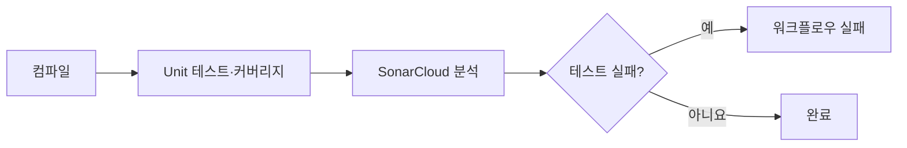

지난 학기 DevOps 수업에서 SonarCloud를 처음 접했다. 당시에는 개발이 끝난 프로젝트의 배포·운영이 목적이라, 개발 중 코드 품질을 지속적으로 관리하는 데 충분히 활용하지 못한 점이 아쉬웠다.

이번 여행 기록 서비스 프로젝트에서는 이 부분을 보완하려고 SonarCloud를 도입했다. 팀원들에게 목적과 장점을 공유하고 CI 파이프라인에서 테스트와 코드 품질 분석을 함께 수행하도록 구성했다.

> **“코드를 더 클린하게 유지하자.”**

Spring Boot 백엔드에서 Gradle과 GitHub Actions를 이용해 연동한 과정이다.

## 환경과 파이프라인

| 항목 | 구성 |
|---|---|
| 애플리케이션 | Spring Boot 3.5.0, Java 21 |
| 빌드 | Gradle |
| CI/CD | GitHub Actions |
| 테스트 | Unit·Integration 테스트 분리 |
| 운영 기준 | dev 브랜치 기준 테스트 실행·SonarCloud 분석 |



## Gradle 설정

### 플러그인과 분석 대상

`build.gradle`에 SonarQube 플러그인과 테스트 커버리지 측정용 JaCoCo를 추가했다.

```groovy
plugins {
    id 'java'
    id 'org.springframework.boot' version '3.5.0'
    id 'io.spring.dependency-management' version '1.1.7'
    id "org.sonarqube" version "7.2.2.6593"
    id 'jacoco'  // 커버리지 측정용
}
```

`sonar` 블록에는 프로젝트 정보, 소스·테스트 경로와 커버리지 리포트를 지정했다.

```groovy
sonar {
    properties {
        property "sonar.projectKey", "<project-key>"
        property "sonar.organization", "<org>"

        // source / test directories
        property "sonar.sources", "src/main/java"
        property "sonar.tests", "src/test/java"

        // coverage report
        property "sonar.coverage.jacoco.xmlReportPaths",
                 "build/reports/jacoco/unitTest/jacocoUnitTestReport.xml"
    }
}
```

DTO, Domain, 설정 코드처럼 품질 지표로 관리할 필요가 없다고 판단한 영역은 제외 대상으로 설정했다.

### Unit 테스트만 커버리지에 포함

JUnit 5의 `@Tag`로 Integration 테스트를 분리하고, 커버리지는 Unit 테스트만 기준으로 측정했다.

```groovy
// Unit 테스트만 실행 (Integration 테스트 제외)
tasks.register('unitTest', Test) {
    useJUnitPlatform {
        excludeTags = ['integration']
    }

    testLogging {
        events "passed", "skipped", "failed"
        showStandardStreams = true
        exceptionFormat = "full"
    }

    finalizedBy jacocoUnitTestReport
}

// Unit 테스트용 JaCoCo 리포트 생성
tasks.register('jacocoUnitTestReport', JacocoReport) {
    dependsOn unitTest
    reports {
        xml.required = true
        xml.outputLocation =
            file("build/reports/jacoco/unitTest/jacocoUnitTestReport.xml")
        html.required = true
        html.outputLocation =
            file("build/reports/jacoco/unitTest/html")
    }

    executionData unitTest
    sourceDirectories.from(files("src/main/java"))
    classDirectories.from(files("build/classes/java/main"))
}
```

> **주의사항**  
> excludeTags는 반드시 useJUnitPlatform() 블록 안에서 설정해야 한다.  
> 블록 밖에 선언하면 Gradle 에러가 발생한다.

Integration 테스트 클래스에는 다음 태그를 지정했다.

```java
@Tag("integration")
@SpringBootTest
public class IntegrationTestBase {
    // ...
}
```

## GitHub Actions 설정

`.github/workflows/sonarcloud.yml`에 CI 파이프라인을 구성했다.

```yaml
name: SonarCloud Analysis

on:
  push:
    branches: [default, development]
  pull_request:
    types: [opened, synchronize, reopened]
    branches: [default, development]

jobs:
  build:
    name: Build and analyze
    runs-on: ubuntu-latest

    steps:
      - name: Checkout code
        uses: actions/checkout@v4
        with:
          fetch-depth: 0

      - name: Set up JDK 21
        uses: actions/setup-java@v4
        with:
          java-version: '21'
          distribution: 'temurin'

      - name: Cache Gradle packages
        uses: actions/cache@v4
        with:
          path: |
            ~/.gradle/caches
            ~/.gradle/wrapper
          key: ${{ runner.os }}-gradle-${{ hashFiles('**/*.gradle*') }}

      - name: Grant execute permission for gradlew
        run: chmod +x gradlew

      - name: Build project (compile only)
        run: ./gradlew clean compileJava compileTestJava

      - name: Run unit tests with coverage
        id: unit_test
        continue-on-error: true
        run: ./gradlew unitTest jacocoUnitTestReport

      - name: SonarCloud Scan
        env:
          SONAR_TOKEN: ${{ secrets.SONAR_TOKEN }}
          GITHUB_TOKEN: ${{ secrets.GITHUB_TOKEN }}
        run: ./gradlew sonar

      - name: Fail if tests failed
        if: steps.unit_test.outcome == 'failure'
        run: exit 1
```

| 설정 의도 | 처리 방식 |
|---|---|
| 테스트가 실패해도 분석 진행 | `continue-on-error: true`로 테스트 실패 후에도 SonarCloud 분석 실행 |
| 실패한 테스트의 머지 차단 | 마지막에 테스트 결과를 확인하고 워크플로우 자체를 실패 처리 |
| PR 자동 코멘트 | `GITHUB_TOKEN`을 이용해 PR에 분석 결과 표시 |

### 토큰 등록

1. SonarCloud의 My Account → Security에서 토큰을 생성한다.
2. GitHub 저장소의 Settings → Secrets and variables → Actions로 이동한다.
3. `SONAR_TOKEN`으로 등록한다.

`GITHUB_TOKEN`은 GitHub Actions에서 자동으로 제공한다.

## 분석 운영과 결과 확인

코드 품질 분석은 테스트 성공 여부와 별개로 의미가 있다. 실패한 테스트가 있어도 일부 커버리지는 측정할 수 있고, PR 작성자는 테스트와 품질 분석 결과를 함께 볼 수 있다. 마지막에 테스트 실패를 워크플로우 실패로 처리해 머지를 차단하도록 구성했다.

| 분석 방식 | 기준 |
|---|---|
| Push 분석(dev/main) | 전체 코드 분석 |
| PR 분석 | 변경된 코드만 분석 |
| 최초 분석 | baseline이 되며 이후 PR에서 비교 기준으로 사용 |

| 확인 위치 | 확인 내용 |
|---|---|
| SonarCloud 대시보드 | 코드 품질, 커버리지, 버그·스멜 지표 |
| GitHub Actions 로그 | 테스트와 분석의 상세 로그 |
| 로컬 HTML 리포트 | `build/reports/tests/unitTest/index.html` |

## 기본 브랜치 문제

### 분석은 됐지만 결과가 보이지 않음

프로젝트에서는 `main` 대신 `dev`를 기본 브랜치로 운영했다. 당시 SonarCloud 무료 플랜에서는 기본 브랜치 하나만 정상적으로 분석 결과를 제공했다.

처음 GitHub 저장소와 연동했을 때는 `main`이 있었고 SonarCloud도 이를 기본 브랜치로 인식했다. 이후 프로젝트 운영 중 GitHub 기본 브랜치를 바꾸고 연동을 재설정했는데, SonarCloud가 다른 브랜치를 기본으로 인식한 것처럼 보였다.

분석 실행과 GitHub Actions 로그에는 문제가 없었지만, SonarCloud 대시보드에서 분석 결과를 볼 수 없었다.

### 추론한 원인

명확한 공식 문서를 찾지는 못했다. 실제 동작을 기준으로 다음과 같이 추론했다.

| 관찰·추론 | 영향 |
|---|---|
| 최초 연동 시점의 GitHub 기본 브랜치를 기준으로 SonarCloud 기본 브랜치가 정해짐 | 이후 변경 시 설정이 어긋날 수 있음 |
| GitHub 기본 브랜치 변경 후 재연동 | SonarCloud 설정과 불일치 가능 |
| 무료 플랜은 기본 브랜치 하나만 활성화 | 분석은 실행돼도 결과를 볼 수 없는 상황 발생 |

> **GitHub의 default branch 변경 이력이 SonarCloud 기본 브랜치 인식에 영향을 준 것**으로 보인다.

### 해결과 남은 경험

이론적으로는 SonarCloud Web UI에서 Project Settings → General Settings → Branches → Main Branch를 변경할 수 있었다. 하지만 당시에는 Organization owner 권한이 없어 설정을 바꾸지 못했다.

팀원들과 논의한 뒤 **SonarCloud Organization을 삭제하고 재생성**하는 방법으로 해결했다. 이 과정에서 멤버와 owner의 권한 차이, 무료 플랜의 기본 브랜치 하나 제한, GitHub 기본 브랜치 변경 이력이 동작에 영향을 줄 가능성을 알게 됐다. 대부분의 제약은 유료 플랜에서 해소할 수 있었다.

## 연동 후 정리한 점

PR 단위의 코드 품질 분석과 자동 피드백 환경을 구성했다. Unit 테스트만 커버리지에 포함하고, 테스트가 실패해도 분석을 실행한 뒤 최종 실패로 처리하는 CI 흐름을 만들 수 있었다.

코드를 나중에 정리할 대상이 아니라 지속적으로 관리할 자산으로 다루는 데 SonarCloud를 활용할 수 있었다.
