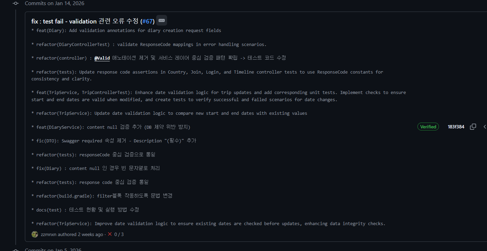
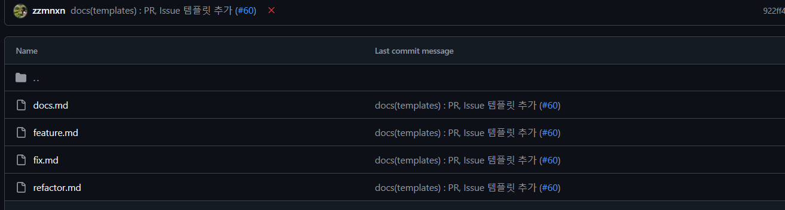
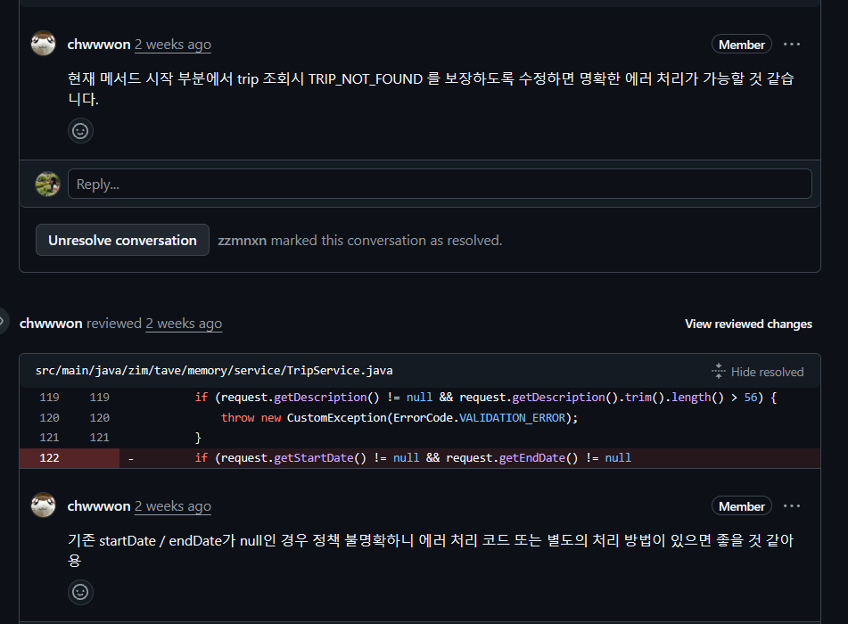

앱 개발이 아직 끝나지 않은 시점에, 이번 프로젝트의 협업 방식을 한 번 정리해 보고 싶었다. 커밋과 브랜치, Issue, 코드 리뷰를 정비하면서 **어떻게 함께 개발할 것인가**가 코드 품질과 유지보수성에 얼마나 큰 영향을 주는지 체감했다.

## 커밋 컨벤션: 기록은 남기되, 읽히게

프로젝트 초반에는 최소한의 커밋 컨벤션만 지켰다. `fix: controller` 같은 형식은 사용했지만, 커밋 단위에 대한 기준은 명확하지 않았다.

그 결과 하나의 커밋에 너무 많은 변경 사항이 들어갔다. 나중에 커밋 히스토리를 다시 보면 “이 코드는 언제, 왜 바뀐 거지?”라는 질문에 바로 답하기 어려웠다.

그래서 팀원들과 합의한 목표는 단순했다.

> 커밋 히스토리만 봐도  
> 이 코드가 어디가, 왜, 어떤 의도로 바뀌었는지 알 수 있도록 하자.

이를 위해 커밋을 **의미 단위**로 나누고, `main` 브랜치를 깨끗하게 유지하기 위해 squash & merge 방식을 사용했다.

| 구분 | 남기는 내용 |
|---|---|
| 개별 커밋 | 세부 변경 사항과 맥락 |
| squash 커밋 | 하나의 기능이나 변경을 대표하는 메시지 |

덕분에 `main` 브랜치는 보기 좋은 히스토리를 유지하면서도, 필요하면 PR 내부 커밋을 통해 세부 흐름을 추적할 수 있게 됐다.



## 브랜치 전략: 사람 단위에서 기능 단위로

이전 개발에서는 팀원 각자 이름으로 브랜치를 만들어 작업했고, 작업이 끝나면 `main`에 바로 반영했다. 하지만 리팩토링과 신규 기능이 동시에 늘어나면서 어떤 변경이 어떤 기능에 속하는지 파악하기가 점점 어려워졌다.

이번 프로젝트에서는 Git Flow 기반 브랜치 전략을 도입했다.

| 기준 | 규칙 |
|---|---|
| 브랜치 단위 | 기능별로 생성 |
| 이름 | `feature/{issue-number}-{description}` |
| PR 단위 | 브랜치 하나당 PR 하나 |

처음에는 기능 단위 브랜치가 번거롭게 느껴졌지만, 사용해 보니 장점이 더 컸다. 기능별 히스토리가 서로 섞이지 않았고, `dev` 브랜치를 기준으로 개발 진행 상황이 명확해졌다. PR을 리뷰할 때도 변경 범위가 깔끔하게 보였다.

## PR 템플릿: 코드를 보기 전에 맥락을 공유하다

이전에는 PR을 각자 자유롭게 작성했다. 그러다 보니 리뷰어가 코드를 먼저 읽고 맥락을 유추해야 하는 상황이 자주 발생했다.

이를 개선하기 위해 관련 Issue, 변경 배경(What / Why), 핵심 변경 사항, 테스트 체크리스트를 담은 PR 템플릿을 도입했다.

```markdown
## 🔗 Related Issue
- #123 

## 📝 Description
> 무엇을(What), 왜(Why) 변경했는지 설명합니다.

### 기획 배경 및 비즈니스 문제
- 예: 기존 결제 시스템에서 특정 카드사의 할부 승인이 거절되는 문제를 해결하기 위해 로직을 수정했습니다.

## 🛠 Changes
> 핵심 변경 사항을 요약합니다.

- **API 변경**: `POST /api/v1/payments` 엔드포인트에 `installment_month` 파라미터 추가
- **DB 스키마**: `orders` 테이블에 `promotion_code` 컬럼 추가

## ✅ Test Checklist
> 변경 사항이 정상적으로 동작하는지 확인하기 위해 수행한 테스트 목록입니다.

- [ ] 단위 테스트(Unit Test)를 작성하고 통과했나요?
- [ ] 관련 API 응답 결과가 기획서와 일치하는지 확인했나요?
```

이 템플릿 덕분에 리뷰어는 왜 이 코드가 필요한지 먼저 이해한 상태에서 리뷰할 수 있었다. 작성자 입장에서도 변경 의도를 스스로 정리하는 계기가 됐다.

## Issue: 의사결정의 맥락을 남기다

이번 프로젝트에서 가장 만족스러웠던 변화 중 하나는 GitHub Issue를 적극적으로 활용하게 된 점이다. 이전에는 회의에서 결정한 내용이 시간이 지나면 흐려지거나, 왜 이런 선택을 했는지 기억나지 않는 경우가 많았다.

Issue를 도입한 이후에는 다음 흐름으로 개발했다.

1. 회의 후 `docs` / `feature` / `fix` / `refactor` 중 유형을 골라 Issue를 발행하고, 왜(Why), 무엇을(What), 어떻게(How) 변경할지 명시한다.
2. Issue를 기반으로 브랜치를 생성한다.
3. PR과 Issue를 연동한다.
4. 코드 리뷰와 수정을 거쳐 squash & merge한다.

이 방식의 가장 큰 장점은 **의사결정의 맥락이 기록으로 남는다는 점**이었다. 장기 개발을 하다 보면 “왜 이 코드를 이렇게 작성했지?”라는 질문을 다시 마주한다. 그럴 때 관련 Issue를 찾아보면 당시의 고민과 결정을 다시 확인할 수 있었다.

실제로 테스트 코드를 작성하면서 DTO의 `@Valid` 검증과 서비스 계층의 검증 로직이 분리된 이유를 이전 Issue와 PR을 통해 파악한 경험이 있다. 당시 “모든 검증 로직은 서비스에서 처리한다”는 의사결정을 확인했고, 이를 바탕으로 검증 로직을 정리하는 리팩토링을 진행했다. 그 과정은 [검증 로직의 위치: 테스트로 드러난 설계 문제](../spring-validation-service)에 정리했다.



## 가장 잘 도입했다고 느낀 것: 코드 리뷰

여러 협업 방식 중에서 가장 잘 도입했다고 느낀 것은 코드 리뷰였다. Issue와 PR을 통해 충분히 고민했다고 생각한 코드도, 리뷰 과정에서는 항상 놓친 부분이 발견됐다.

- 리팩토링이 덜 된 코드
- 불필요한 의존성
- 예외 처리 누락
- 코드 스타일의 미묘한 불일치

이번 개발 기간에는 리팩토링 비중이 컸다. 코드 리뷰가 없었다면 이런 코드가 그대로 `main`에 들어갔을 것이라고 생각하니 아찔했다.



이 과정에서 발견한 세부적인 실수들과 트러블슈팅 경험은 [티스토리의 Backend / Trouble Shooting 카테고리](https://wlals916.tistory.com/category/Backend/Trouble%20Shooting)에 별도로 정리해 두었다.

## 나중의 나와 팀원을 위한 기록

중간 회고를 정리하면서, 협업 규칙은 개발 속도를 늦추기 위한 장치가 아니라 **나중의 나와 팀원을 위한 투자**라고 느꼈다.

프로젝트가 끝난 뒤 이 글을 다시 읽으면서 “그래도 이때는 제대로 고민하면서 개발했구나”라고 말할 수 있기를 바란다.
